# PCR Postfit Metrics

`PCR Postfit Metrics` is a post-fit evaluation framework for phylogeneticists who already have a set of competing chronograms and need to decide which ones are the most biologically defensible.

In simple terms, the core idea is that divergence-time estimation is hard: the resulting chronogram can shift substantially with clock-model choice, tree priors, calibration priors, and other analytical decisions ([Lepage et al. 2007](https://doi.org/10.1093/molbev/msm193); [dos Reis et al. 2016](https://doi.org/10.1038/nrg.2015.8); [Bromham et al. 2018](https://doi.org/10.1111/brv.12390)). A practical response is to compare a defensible set of alternative chronograms after they have been estimated, rather than betting everything on a single, computationally intensive "gold-standard" analysis and then treating that one tree as settled.

It is method-agnostic. The candidates can come from `BEAST`, `MCMCTree`, `MrBayes`, `chronos`, `treePL`, `RelTime`, or any other dating workflow.

PCR starts from finished chronograms. If you need to generate a set of chronograms from alternative methods (`chronos`, `treePL`, `RelTime`, and optionally `MD-Cat`) using an unconstrained phylogram and a calibration set, you can do that here: [PCR Custom Dating Pipeline From Phylograms](../1_PCR_CUSTOM_DATING_PIPELINE_FROM_PHYLOGRAMS/README.md).

## What it evaluates

`PhyloChronoRank (PCR)` uses three core metric families grouped by scope, what part of the tree they evaluate:

- **Family 1** evaluates radiation zones (cladogenetic bursts)
- **Family 2** evaluates global tree structure outside bursts
- **Family 3** evaluates the dating method's parametric behavior (rates and calibration fit)

Within each family, per-metric ranks are averaged; across families, the three family averages are averaged. This ensures no single scope dominates regardless of metric count per family. These are implementation-level diagnostics rather than named published indices; the citations below support the underlying biological ideas each family is trying to capture. All PCR scores are oriented so that lower is better, except `internode_concordance` and `depth_r2` where higher is better. Values are compared at 3 significant digits, so differences at the level of numerical noise are ties; ties use `average` ranking to preserve the rank-sum invariant. Candidates that are the same tree (for example one `RelTime` tree saved with Tao and with bootstrap intervals) are scored once. When all candidates produce the same raw value on a metric (zero variance), that metric is excluded via `NA` so it cannot dilute discriminatory metrics.

### Family 1 — Radiation-Zone Fidelity (1/3)

**Metrics:** `burst_loss`, `internode_concordance`

This family asks whether a dated tree keeps the same branching rhythm seen in the source phylogram within rapid radiations. In practice, this means preserving the clustered speciation bursts (short internodes packed together) instead of smearing them into evenly spaced splits.

The biological motivation is that substitution-rate bursts associated with speciation events are well documented: [Pagel et al. (2006)](https://doi.org/10.1126/science.1129647) showed that a large fraction of molecular divergence accumulates in punctuational bursts at cladogenesis rather than gradually along branches. The RCS (Relaxed Clock with Spikes) model formalizes this, showing that punctuated molecular evolution is detectable and should be preserved by dating methods ([Manceau et al. 2020](https://doi.org/10.1093/molbev/msaa144)). [Duchêne et al. (2022)](https://doi.org/10.1186/s12862-022-02024-5) showed that standard relaxed-clock models can fail to recover correct divergence times when molecular evolution is punctuated rather than gradual, exactly the failure mode these metrics are designed to catch.

- `burst_loss`: How much of the radiation-burst signal is destroyed during dating. If the phylogram shows tightly clustered speciation events (short internodes packed together, separated by longer quiet intervals) and the chronogram smears them into evenly spaced splits, the penalty is high. This measures loss of temporal clustering (the CV of inter-event spacing drops), not branch collapse to zero.

- `internode_concordance`: Whether the variability of internal branch lengths within each radiation zone is preserved. Within a radiation zone, the phylogram might show a mix of very short and moderately short internodes (high CV); a good chronogram should maintain that same spread rather than making all internodes uniformly equal (low CV). This complements `burst_loss`: burst_loss measures whether the temporal clustering of node depths is smeared out, while internode_concordance measures whether the spread of individual branch lengths within the zone is preserved. In most datasets the two metrics are correlated, but not always: they can rank candidates in opposite directions, so they capture different aspects of radiation-zone fidelity.

### Family 2 — Global Chronogram Fidelity (1/3)

**Metrics:** `compression_score`, `depth_r2`

Outside radiation zones, the backbone of the tree (the deep splits and the overall pacing of divergence events) should be largely preserved from phylogram to chronogram, modulated by rate variation. Different relaxed-clock models accommodate rate heterogeneity in different ways ([Lartillot et al. 2016](https://doi.org/10.1098/rstb.2015.0132); [Lepage et al. 2007](https://doi.org/10.1093/molbev/msm193)), and model choice directly affects how faithfully backbone timing is recovered. This family checks whether the dating method introduced global distortions.

- `compression_score`: Detects places where the chronogram collapses well-separated phylogram branches into near-simultaneous splits that were not in the original tree. This flags artificial compression, a known artifact where prior specifications and clock model choices can systematically distort branch lengths ([Bromham et al. 2018](https://doi.org/10.1111/brv.12390)). A recurrent issue with some dating methods, particularly `RelTime`, where genuine divergence events get squeezed into near-polytomies.

- `depth_r2`: Overall correlation between node depths in the phylogram and chronogram. A high R² means the chronogram largely respects the relative ordering and spacing of divergence events encoded in the phylogram. Under realistic rate variation this will not be perfect, but a good dating method should not scramble the depth structure.

### Family 3 — Rate & Calibration (1/3)

**Metrics:** `rate_irregularity`, `mean_relative_gap`

For each branch, dividing the phylogram branch length (substitutions) by the chronogram branch duration (time) gives an implied evolutionary rate. This family evaluates whether those implied rates are biologically plausible and whether the chronogram respects its calibration constraints. Rate estimation and calibration fit are the two fundamental axes along which dating methods can fail independently of tree topology ([dos Reis et al. 2016](https://doi.org/10.1038/nrg.2015.8); [Ho & Duchêne 2014](https://doi.org/10.1111/mec.12953)).

- `rate_irregularity`: The score rises when implied rates are too dispersed, jump sharply from parent to child branch, produce too many outlier branches, or lose the positive autocorrelation expected among closely related lineages. This follows the penalized-likelihood and relaxed-clock literature on among-lineage rate variation and autocorrelation ([Sanderson 2002](https://doi.org/10.1093/oxfordjournals.molbev.a003974); [Lepage et al. 2007](https://doi.org/10.1093/molbev/msm193); [Ho & Duchêne 2014](https://doi.org/10.1111/mec.12953)). The metric penalizes erratic, unpatterned rate jumps that suggest overfitting or poor convergence rather than genuine biological rate heterogeneity.

- `mean_relative_gap`: For non-fixed calibration constraints (ranges, not point calibrations), measures how far estimated node ages sit from calibration interval boundaries relative to interval width. A chronogram that places calibrated nodes right at the edge of their prior ranges may be "rail-riding," constrained by the prior rather than informed by the data ([Szöllősi et al. 2022](https://doi.org/10.1093/sysbio/syab084)). This is the same general idea as ghost-lineage and stratigraphic-congruence measures ([Huelsenbeck 1994](https://doi.org/10.1017/S009483730001294X); [Wills 1999](https://doi.org/10.1080/106351599260148)). It should be interpreted carefully: fossils usually provide minimum ages, not true lineage origins, so a tree that minimizes this too aggressively can simply be too young overall ([Parham et al. 2012](https://doi.org/10.1093/sysbio/syr107)). `NA` when all calibrations are fixed, in which case it drops from Family 3.

### Uncertainty Width (Optional Precision Layer)

Measures how wide the confidence or credible intervals are around estimated node ages. Narrower intervals indicate greater precision, though precision and accuracy are distinct properties. Frequentist confidence intervals and Bayesian credibility intervals arise from different statistical frameworks and are not directly commensurable ([Paradis et al. 2023](https://doi.org/10.1016/j.ympev.2022.107652); [Drummond et al. 2006](https://doi.org/10.1371/journal.pbio.0040088); [Bromham 2019](https://doi.org/10.1016/j.tree.2019.01.017); [Tao et al. 2020a](https://academic.oup.com/mbe/article/37/1/280/5602325); [Tao et al. 2020b](https://academic.oup.com/mbe/article/37/6/1819/5771370)), so they are usually reported side by side rather than collapsed into one score ([Costa et al. 2022](https://bmcgenomics.biomedcentral.com/articles/10.1186/s12864-022-09030-5); [Beavan et al. 2020](https://academic.oup.com/gbe/article/12/7/1087/5842139)). PCR reports the mean width of the 95% intervals (when a tree carries 95% and 50% intervals, only the 95% ones are used). It does not check that the intervals of different candidates come from comparable methods, so compare widths only among candidates with the same kind of interval (for example the Poisson branch-length bootstrap used for `chronos`, `treePL`, `RelTime` and `MD-Cat` in this repo). The analytical `RelTime` CI of [Tao et al. 2020a](https://academic.oup.com/mbe/article/37/1/280/5602325) can differ sharply from bootstrap widths; in the examples below the `RelTime` candidate carries its bootstrap intervals where they exist. A node that a method fixes at a calibration (a point age, or a bound it ends on) gets a zero-width interval, so with many calibrations the mean width is smaller.

### Scoring Procedure

1. Rank candidates per metric (lower = better, except `internode_concordance` and `depth_r2` where higher = better).
2. Zero-variance exclusion: if all candidates tie on a metric, it carries no discriminatory power and is set to `NA`.
3. Average ranks within each family (`na.rm = TRUE`).
4. Average the three family scores for the final composite rank.

<details>
<summary><strong>Compact formulas used in the current implementation</strong></summary>

#### Family 1

`burst_loss`

```text
burstiness = sd(inter-event waits) / mean(inter-event waits)   # CV of spacing
burst_loss_clade = max(0, (burstiness_ref - burstiness_est) / (burstiness_ref + 1e-12))
mean_burst_loss = weighted mean across matched radiation-zone clades
weight_clade = log(1 + n_tips) * sqrt(n_events)
```

What it means: how much temporal clustering was smeared away in each matched radiation zone. A burstiness CV near 1 or above means events are tightly clustered with quiet gaps between clusters; a CV near 0 means events are evenly spaced. `burst_loss` measures the fractional drop in that CV. Larger and more event-rich zones are given more weight.

`internode_concordance`

```text
cv_ref = internode CV in the reference phylogram subclade
cv_est = internode CV in the candidate chronogram subclade
concordance = min(cv_ref, cv_est) / max(cv_ref, cv_est)
internode_concordance = mean(concordance) across matched radiation zones
```

What it means: a ratio near 1 means the chronogram preserves the same coefficient of variation of internal branch lengths as the phylogram within each radiation zone. A low concordance value means the dating method changed how variable the internodes are, typically making them more uniform. This differs from `burst_loss`, which operates on cumulative node-depth gaps rather than individual branch lengths.

#### Family 2

`compression_score`

```text
est_near_zero = 0.1% of chronogram total depth
ref_short_threshold = 5th percentile of phylogram internal branch lengths
compressed = branches where chronogram_bl <= est_near_zero AND phylogram_bl > ref_short_threshold
compression_score = n_compressed / n_total_matched_internal
```

What it means: fraction of internal branches that the chronogram collapsed to near-zero length even though the phylogram shows non-trivial branch lengths there. Higher = more artificial compression.

`depth_r2`

```text
Match all internal nodes between phylogram and chronogram by tip-set signature.
Normalize depths to [0, 1] within each tree.
depth_r2 = R² from lm(chronogram_depth ~ phylogram_depth)
```

What it means: overall goodness-of-fit between relative node depths. Higher R² = the chronogram respects the phylogram's depth structure.

#### Family 3

`rate_irregularity`

```text
branch_rate = phylogram_branch_length / chronogram_branch_duration
log_rate_sd = sd(log(branch_rate))
parent_child_jump = mean(|log(child_rate) - log(parent_rate)|)
extreme_rate_frac = fraction of branches with log(rate) outside 1.5 * IQR of log-rates
autocorr_penalty = 1 - max(Spearman_rho(parent_rate, child_rate), 0)
rate_irregularity = log_rate_sd + parent_child_jump + 2 * extreme_rate_frac + autocorr_penalty
```

What it means: the score rises when branchwise rates are more dispersed, jump more sharply from parent to child, produce more extreme outlier branches, or lose positive autocorrelation. The autocorrelation component is important because well-behaved relaxed clocks produce rates that are correlated between adjacent branches; a dating method that creates erratic parent-child rate jumps is likely imposing node placements that conflict with the molecular signal.

`mean_relative_gap`

```text
For each non-fixed (window) calibration with age_min >= 0.01 Ma:
  ghost_gap = node_age - age_min
  relative_gap = ghost_gap / age_min
mean_relative_gap = mean(relative_gap) across qualifying calibrations
```

Calibrations with `age_min < 0.01` Ma are excluded because they are effectively unconstrained and produce meaningless ratios. Each qualifying calibration contributes equal weight to the mean.

What it means: the average amount of extra inferred lineage history beyond the calibration minima, scaled by the minimum ages. Fixed (point) calibrations are excluded because there is no window to evaluate. With secondary or congruified ages, report it separately as calibration slack or omit it from the core rank.

#### Overall scoring

```text
family_radiation = mean(rank_burst_loss, rank_internode_concordance)
family_global = mean(rank_compression_score, rank_depth_r2)
family_ratecal = mean(rank_rate_irregularity, rank_mean_relative_gap)
overall_rank = mean(family_radiation, family_global, family_ratecal)
```

What it means: each family contributes exactly `1/3` of the final rank. Within each family, metrics contribute equally. If a metric is `NA` (zero variance or not computable), it drops from its family average. If an entire family is `NA`, the overall score averages across the remaining families.

</details>

## Run PCR on your own data

`PhyloChronoRank (PCR)` includes a standalone runner:

- `scripts/run_pcr.R`

At minimum, it expects:

- one reference phylogram
- one candidate manifest with `candidate,tree_file`

Optional:

- `--calibrations-csv` when you want PCR to score the calibration-fit / gap layer
- `--uncertainty-csv` when you want to report the optional precision layer from a separate interval-width table

If you do not provide `--uncertainty-csv`, PCR will still try to extract interval widths directly from annotated Newick trees.

Example commands:

```bash
Rscript scripts/run_pcr.R \
  --ref-tree=examples/terapontoid/phylogram.tre \
  --candidates-csv=examples/terapontoid/pcr_dense19/candidates.csv \
  --calibrations-csv=examples/terapontoid/Terapontoid_congruified_19.csv \
  --outdir=out/terapontoid
```

```bash
Rscript scripts/run_pcr.R \
  --ref-tree=examples/syngnatharia/backbone_Raxml_besttree_matrix75.tre \
  --candidates-csv=examples/syngnatharia/pcr_rebuild/candidates.csv \
  --calibrations-csv=examples/syngnatharia/pcr_rebuild/calibrations_by_candidate.csv \
  --uncertainty-csv=examples/syngnatharia/uncertainty_summary_long.csv \
  --outdir=out/syngnatharia
```

Each result table below is generated from its `summary_pcr_metrics.csv` (marked by a `pcr-table` comment above the table). To check the tables against the CSVs, or to regenerate them, run:

```bash
Rscript scripts/validate_examples.R
```

```bash
Rscript scripts/readme_tables.R --write
```

Tables of unpublished datasets are skipped when their CSV is not in the repo.

## Example 1: Two published chronograms plus MD-Cat (Syngnatharia)

### Visual choice before metrics

This example does not start from a `chronos` fit search. It starts from an earlier visual comparison among the `RAxML` phylogram (164 tips), `MCMCTree`, and `RelTime`. In that comparison, the practical choice was to favor `RelTime` because it visually preserved the diversification bursts in the phylogram better than `MCMCTree`, as discussed in [Santaquiteria et al. 2024](https://www.journals.uchicago.edu/doi/10.1086/733931). The post-fit metrics quantify that visual rationale. A third candidate, `MDCat`, was dated here from the same phylogram with the `RelTime` calibration set (see [MD-Cat](../1_PCR_CUSTOM_DATING_PIPELINE_FROM_PHYLOGRAMS/README.md#md-cat)).

### Quick takeaway

- `RelTime` is the core PCR winner (1.33), then `MDCat` (2.17) and `MCMCTree` (2.50)
- `RelTime` wins Family 1 (radiation-zone fidelity) and Family 2 (global fidelity)
- Family 3 (rate and calibration) is a three-way tie: `RelTime` has the most regular rates, `MDCat` the smallest calibration gap
- `MCMCTree` (6.24 Ma) and `MDCat` (6.58 Ma) have narrower intervals than `RelTime` (11.41 Ma). These are three kinds of interval (HPD, Poisson bootstrap and the paper's `RelTime` CI), so compare the widths with care
- `Figure A` is the original visual rationale from the paper; `Figure B` is the quantitative post-fit follow-up

### Figure A: Original visual rationale from the paper

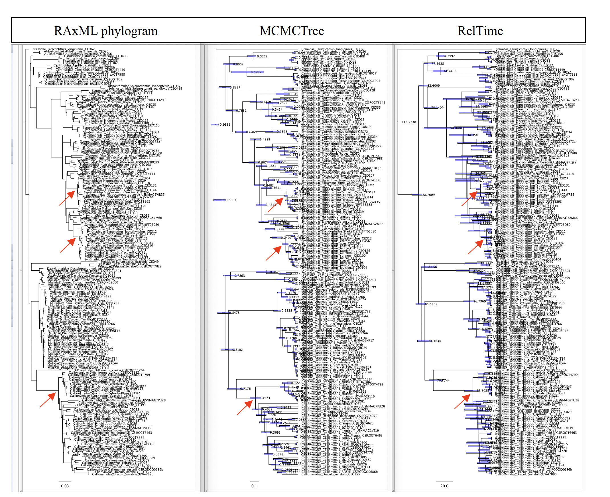

This is the original paper figure from [Santaquiteria et al. 2024](https://www.journals.uchicago.edu/doi/10.1086/733931) that motivated the visual preference for `RelTime`. The RAxML phylogram on the left shows clustered branching bursts in several parts of the tree. In the middle panel, `MCMCTree` spreads many of those events out more evenly through time. In the right panel, `RelTime` better tracks the burst structure seen in the phylogram. This panel addresses the radiation-zone fidelity issue only. It does not show the global fidelity, rate, or calibration layers.

### Ranked post-fit results (lower is better, except int. concordance and depth R²)

The gap layer is informative here because the calibrations are fossil minimum ages and intervals (Table S2 of the paper), not congruified ages. The two published trees were dated with different calibration sets (13 rows for `RelTime`, 14 for `MCMCTree`, including a root interval of 92–103.5 Ma that only `MCMCTree` used), so each candidate is checked against its own set; `MDCat` uses the `RelTime` set. The interval widths of the two published trees were measured from the paper figure (`syngnatharia_HPD_widths_extracted.csv`), so they are approximate. The `MDCat` intervals come from its Poisson branch-length bootstrap (100 replicates).

<!-- pcr-table: examples/syngnatharia/pcr_rebuild/summary_pcr_metrics.csv -->
| candidate | burst loss | int. concordance | compression | depth R² | rate irregularity | mean relative gap | uncertainty width (Ma) | Fam 1 | Fam 2 | Fam 3 | core rank |
| --- | ---: | ---: | ---: | ---: | ---: | ---: | ---: | ---: | ---: | ---: | ---: |
| `RelTime` | 0.162 | 0.925 | 0.000 | 0.113 | 1.151 | 0.269 | 11.41 | 1.00 | 1.00 | 2.00 | **1.33** |
| `MDCat` | 0.170 | 0.738 | 0.000 | 0.078 | 2.065 | 0.100 | 6.58 | 2.50 | 2.00 | 2.00 | 2.17 |
| `MCMCTree` | 0.240 | 0.810 | 0.000 | 0.058 | 1.553 | 0.218 | 6.24 | 2.50 | 3.00 | 2.00 | 2.50 |

### Figure B: Post-fit comparison across metric families

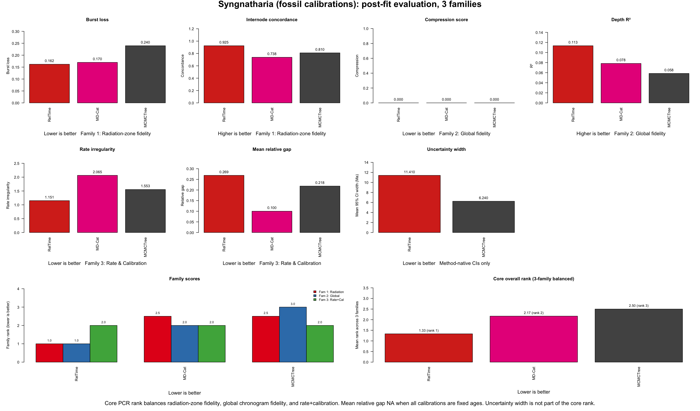

`compression_score` is zero for all three candidates, so it drops from Family 2 (zero-variance exclusion) and Family 2 is `depth_r2` alone.

The uncertainty-width separation is deliberate. The RelTime literature does not support a simple story that wider intervals are automatically worse. Broader RelTime intervals are often discussed as a precision-versus-coverage tradeoff: the analytical procedure propagates branch-length uncertainty and rate heterogeneity, which can give wider intervals with better coverage ([Tao et al. 2020](https://academic.oup.com/mbe/article/37/1/280/5602325); [Costa et al. 2022](https://bmcgenomics.biomedcentral.com/articles/10.1186/s12864-022-09030-5); [Beavan et al. 2020](https://academic.oup.com/gbe/article/12/7/1087/5842139)). That is why PCR reports interval width separately rather than treating it as a fourth family.

### Interpretation for this example

- `RelTime` wins (1.33). It best preserves the burst structure and internode variability within radiation zones (burst loss 0.162, concordance 0.925), consistent with the original visual rationale, and has the highest depth R² (0.113)
- `RelTime` is not clean on calibrations: its root (116.7 Ma) is older than the root interval used for `MCMCTree`, and it puts the *Fistularia*–*Aulostomus* node 4.0 Ma above that calibration's 61.5 Ma maximum
- `MDCat` is second (2.17). It keeps the burst structure almost as well as `RelTime` (burst loss 0.170) but has the least regular rates (2.065) and the lowest concordance (0.738). Its small calibration gap (0.100) comes from how it handles bounds: MD-Cat takes fixed ages only, and 9 of its 13 calibrated nodes ended at their fossil minimum
- `MCMCTree` is third (2.50), with the weakest burst preservation (0.240) and depth R² (0.058)
- The post-fit metrics support the original visual choice of `RelTime` ([Santaquiteria et al. 2024](https://www.journals.uchicago.edu/doi/10.1086/733931)), with the caveat on its calibration fit

<details>
<summary><strong>Files behind this example</strong></summary>

- `examples/syngnatharia/backbone_Raxml_besttree_matrix75.tre`
- `examples/syngnatharia/CalibratedTree_backbone_MCMCTree_matrix75_RAXML.tre`
- `examples/syngnatharia/CalibratedTree_backbone_RelTime_matrix75_RAXML.tre`
- `examples/syngnatharia/calibrations_by_candidate.csv`
- `examples/syngnatharia/mdcat_run/` (MD-Cat run; `MAIN_OUTPUT_TREES/MDCat_with_CI.tre`)
- `examples/syngnatharia/syngnatharia_HPD_widths_extracted.csv`, `uncertainty_summary_long.csv`
- `examples/syngnatharia/pcr_rebuild/` (`candidates.csv`, `summary_pcr_metrics.csv`)
- `examples/syngnatharia/Fig_S5_Burst_preservation.png`
- `figures/syngnatharia_postfit_metric_family_values.png`

</details>

## Example 2: Terapontoidei — sparse and dense congruified calibrations

This example uses a 105-tip percomorph phylogeny (Terapontoidei; 29 pulse-panel clades, 13 radiation zones). The **dense** scheme has 19 ages congruified from `examples/terapontoid/ref_timetree.tre`. The **sparse** scheme has 6 of those 19 (the deepest major nodes, chosen with the same rule as the sparse Vertebrate and Tetraodontiformes sets). Both schemes were dated with the current staged pipeline ([Part 1](../1_PCR_CUSTOM_DATING_PIPELINE_FROM_PHYLOGRAMS/README.md)): four `chronos` models, `treePL` with cross-validated smoothing, `RelTime` via MEGA-CC, and `MDCat`.

All calibrations are fixed point ages, so `mean_relative_gap` is NA and Family 3 is rate irregularity alone. `compression_score` is zero for every candidate, so Family 2 is depth R² alone. In both schemes `chronos_relaxed` converges to the same tree as `chronos_correlated`, so PCR scores that tree once, as `chronos_correlated`.

### Figure A: Pulse-layer tree-shape comparison among chronos trees

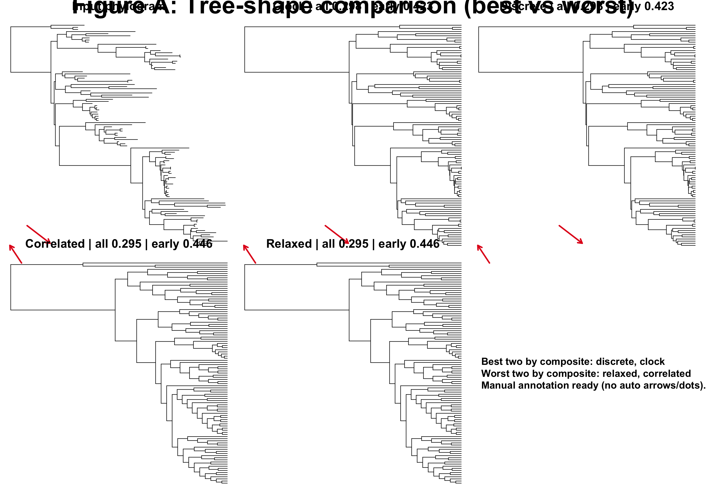

This figure illustrates the pulse layer on alternative `chronos` trees (clock, discrete, correlated, relaxed). It was drawn from an earlier set of `chronos` fits, not from the trees scored below, and it does not show `treePL`, `RelTime` or `MDCat`.

### Scheme 1: Sparse calibrations (6 congruified ages)

<!-- pcr-table: examples/terapontoid/pcr_sparse6/summary_pcr_metrics.csv -->
| candidate | burst loss | int. concordance | compression | depth R² | rate irregularity | uncertainty width (Ma) | Fam 1 | Fam 2 | Fam 3 | core rank |
| --- | ---: | ---: | ---: | ---: | ---: | ---: | ---: | ---: | ---: | ---: |
| `RelTime_MEGA` | 0.108 | 0.887 | 0.000 | 0.325 | 2.119 | 9.23 | 2.00 | 1.00 | 1.00 | **1.33** |
| `chronos_discrete_lambda1_k2` | 0.133 | 0.904 | 0.000 | 0.239 | 2.514 | 3.83 | 2.50 | 5.50 | 2.00 | 3.33 |
| `chronos_clock_lambda1` | 0.133 | 0.904 | 0.000 | 0.239 | 2.516 | 2.91 | 2.50 | 5.50 | 3.00 | 3.67 |
| `chronos_correlated_lambda0p01` | 0.125 | 0.604 | 0.000 | 0.261 | 4.517 | 0.56 | 4.00 | 2.00 | 6.00 | 4.00 |
| `treePL_smooth1000` | 0.185 | 0.775 | 0.000 | 0.254 | 3.360 | 5.76 | 5.00 | 3.00 | 4.00 | 4.00 |
| `MDCat` | 0.202 | 0.787 | 0.000 | 0.245 | 3.464 | 8.17 | 5.00 | 4.00 | 5.00 | 4.67 |

### Scheme 2: Dense calibrations (19 congruified ages)

<!-- pcr-table: examples/terapontoid/pcr_dense19/summary_pcr_metrics.csv -->
| candidate | burst loss | int. concordance | compression | depth R² | rate irregularity | uncertainty width (Ma) | Fam 1 | Fam 2 | Fam 3 | core rank |
| --- | ---: | ---: | ---: | ---: | ---: | ---: | ---: | ---: | ---: | ---: |
| `RelTime_MEGA` | 0.093 | 0.854 | 0.000 | 0.269 | 2.211 | 5.84 | 2.00 | 1.00 | 1.00 | **1.33** |
| `chronos_discrete_lambda1_k2` | 0.112 | 0.893 | 0.000 | 0.235 | 2.584 | 1.80 | 2.00 | 3.50 | 2.00 | 2.50 |
| `chronos_clock_lambda1` | 0.112 | 0.893 | 0.000 | 0.235 | 2.587 | 1.66 | 2.00 | 3.50 | 3.00 | 2.83 |
| `treePL_smooth1000` | 0.157 | 0.762 | 0.000 | 0.242 | 3.463 | 4.15 | 5.00 | 2.00 | 4.00 | 3.67 |
| `MDCat` | 0.172 | 0.783 | 0.000 | 0.233 | 3.507 | 5.58 | 5.00 | 5.00 | 5.00 | 5.00 |
| `chronos_correlated_lambda0p01` | 0.117 | 0.590 | 0.000 | 0.230 | 4.484 | 0.20 | 5.00 | 6.00 | 6.00 | 5.67 |

### Figure B: Post-fit comparison — sparse calibrations

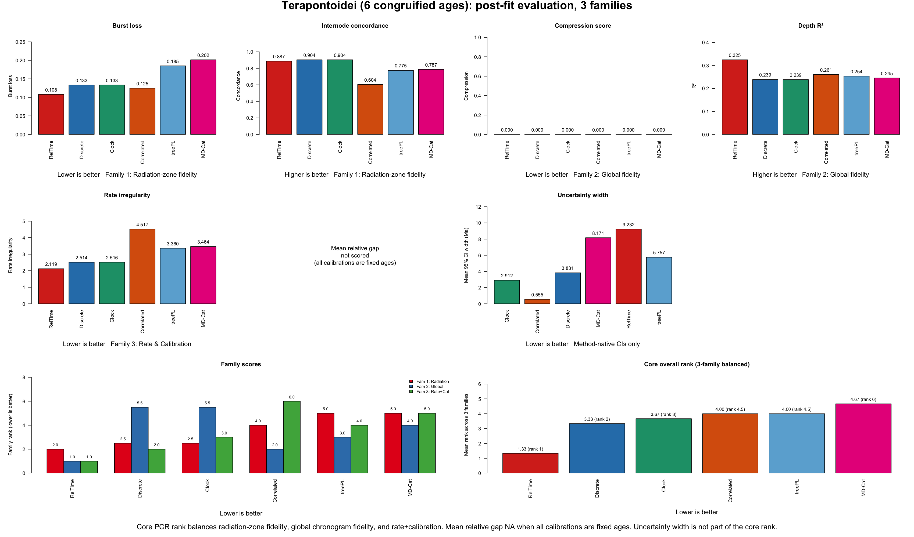

### Figure C: Post-fit comparison — dense calibrations

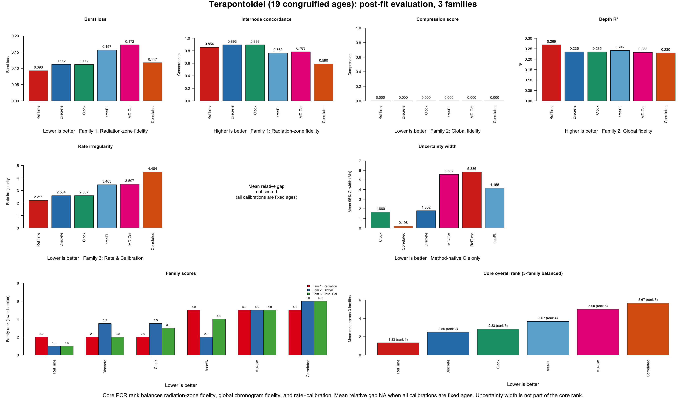

### Interpretation

- `RelTime` wins under both schemes (1.33). It has the lowest burst loss (0.108 sparse, 0.093 dense), the highest depth R² and the most regular rates
- `chronos_discrete` and `chronos_clock` come next in both schemes. They are nearly the same tree: burst loss, concordance and depth R² agree to three digits, and rate irregularity differs only in the third digit (2.514 vs 2.516 sparse). Treat them as equivalent. They keep the internode variability best (concordance 0.904 sparse, 0.893 dense)
- `treePL` (cross-validation picks smoothing 1000 in both schemes) is mid-field: 4.00 sparse, 3.67 dense
- `MDCat` is 4.67 sparse and 5.00 dense. With fixed point ages it smooths the radiation zones more than `RelTime` (burst loss 0.202 sparse, 0.172 dense) and has less regular rates (about 3.5)
- `chronos_correlated` (= `chronos_relaxed`) has the narrowest intervals but the lowest concordance (about 0.60) and the least regular rates (about 4.5)
- `MDCat`, `treePL` and `RelTime` all have Poisson-bootstrap intervals here. `MDCat`'s are wider than `treePL`'s (8.17 vs 5.76 Ma sparse, 5.58 vs 4.15 dense) and a little narrower than `RelTime`'s (9.23, 5.84). Part of the `MDCat` width is the spread between its random starts ([Part 1](../1_PCR_CUSTOM_DATING_PIPELINE_FROM_PHYLOGRAMS/README.md#md-cat))
- Going from 6 to 19 ages changes the scores but not the order at the top: `RelTime` first, then the clock-like `chronos` models

<details>
<summary><strong>Files behind this example</strong></summary>

- `examples/terapontoid/phylogram.tre`, `examples/terapontoid/ref_timetree.tre`
- `examples/terapontoid/Terapontoid_congruified_19.csv` (dense), `Terapontoid_congruified_6.csv` (sparse), `Terapontoid_congruified_6_selection.csv` (how the 6 were chosen)
- `examples/terapontoid/run_dense19/`, `examples/terapontoid/run_sparse6/` (staged dating runs; `MAIN_OUTPUT_TREES/` holds the candidates)
- `examples/terapontoid/pcr_dense19/`, `examples/terapontoid/pcr_sparse6/` (`candidates.csv`, `summary_pcr_metrics.csv`)
- `figures/branching_tempo_tree_panel_clean_v3.png`, `figures/terapontoid_postfit_FEW.png`, `figures/terapontoid_postfit_MANY.png`

</details>

## Example 3: Unpublished vertebrate dataset (581 tips)

This phylogenomic dataset (581 tips; 177 pulse-panel clades, 113 radiation zones) is dated under a **sparse** scheme (18 congruified ages) and a **dense** scheme (57 congruified ages). Unlike the other congruified sets here, every age is an interval (the narrowest is 8.8 Myr wide), so `mean_relative_gap` is scored. The root interval is 517.3–590.8 Ma. Most candidates put the root at the 590.8 Ma upper bound, so the deepest ages depend on that bound.

Candidates: four `chronos` models and `RelTime` from the earlier pipeline runs, `treePL` redated with cross-validated smoothing (random CV with replicates), and `MDCat`.

### Scheme 1: Sparse calibrations (18 congruified ages)

<!-- pcr-table: 5_DATASETS_FEW_CALS/vertebrate/pcr_rebuild/summary_pcr_metrics.csv -->
| candidate | burst loss | int. concordance | compression | depth R² | rate irregularity | mean relative gap | uncertainty width (Ma) | Fam 1 | Fam 2 | Fam 3 | core rank |
| --- | ---: | ---: | ---: | ---: | ---: | ---: | ---: | ---: | ---: | ---: | ---: |
| `RelTime_MEGA` | 0.081 | 0.906 | 0.041 | 0.189 | 1.320 | 0.042 | 51.79 | 1.00 | 4.00 | 1.00 | **2.00** |
| `treePL_smooth100` | 0.154 | 0.897 | 0.003 | 0.139 | 1.418 | 0.217 | NA | 2.50 | 3.00 | 3.50 | 3.00 |
| `MDCat` | 0.144 | 0.860 | 0.005 | 0.099 | 2.273 | 0.144 | 24.56 | 3.50 | 4.50 | 4.50 | 4.17 |
| `chronos_discrete_lambda100_k2` | 0.160 | 0.876 | 0.012 | 0.086 | 1.498 | 0.084 | NA | 4.00 | 6.00 | 2.75 | 4.25 |
| `chronos_clock_lambda100` | 0.160 | 0.876 | 0.012 | 0.086 | 1.500 | 0.084 | NA | 4.00 | 6.00 | 3.25 | 4.42 |
| `chronos_relaxed_lambda0p01` | 0.330 | 0.480 | 0.000 | 0.140 | 3.607 | 0.460 | NA | 6.00 | 1.75 | 6.50 | 4.75 |
| `chronos_correlated_lambda0p01` | 0.346 | 0.479 | 0.000 | 0.125 | 3.600 | 0.482 | NA | 7.00 | 2.75 | 6.50 | 5.42 |

Cross-validation picks smoothing 100 for `treePL`. The treePL optimizer settings disagree a lot on this tree: two settings reach worse objectives and give node ages that differ from the chosen tree by a median of up to 27.8%. The pipeline keeps the best objective, but these treePL dates are sensitive to optimizer settings.

### Scheme 2: Dense calibrations (57 congruified ages)

<!-- pcr-table: 5_DATASETS_MANY_CALS/vertebrate/pcr_rebuild/summary_pcr_metrics.csv -->
| candidate | burst loss | int. concordance | compression | depth R² | rate irregularity | mean relative gap | uncertainty width (Ma) | Fam 1 | Fam 2 | Fam 3 | core rank |
| --- | ---: | ---: | ---: | ---: | ---: | ---: | ---: | ---: | ---: | ---: | ---: |
| `RelTime_MEGA` | 0.130 | 0.897 | 0.031 | 0.151 | 1.638 | 0.109 | 20.12 | 1.00 | 4.00 | 2.50 | **2.50** |
| `treePL_smooth1000` | 0.155 | 0.892 | 0.003 | 0.133 | 1.581 | 0.164 | NA | 2.00 | 2.50 | 3.00 | **2.50** |
| `chronos_discrete_lambda0p01_k2` | 0.161 | 0.885 | 0.007 | 0.092 | 1.593 | 0.124 | 22.37 | 3.50 | 5.00 | 2.25 | 3.58 |
| `chronos_clock_lambda0p1` | 0.161 | 0.885 | 0.009 | 0.091 | 1.593 | 0.126 | 27.68 | 3.50 | 6.00 | 2.75 | 4.08 |
| `MDCat` | 0.163 | 0.868 | 0.014 | 0.102 | 2.648 | 0.131 | 21.70 | 5.00 | 5.50 | 4.50 | 5.00 |
| `chronos_relaxed_lambda0p1` | 0.320 | 0.494 | 0.000 | 0.129 | 3.635 | 0.431 | NA | 6.00 | 2.25 | 7.00 | 5.08 |
| `chronos_correlated_lambda0p01` | 0.337 | 0.492 | 0.000 | 0.127 | 3.631 | 0.370 | 19.35 | 7.00 | 2.75 | 6.00 | 5.25 |

Cross-validation picks smoothing 1000 for `treePL`, but the signal is weak. In every CV replicate the CV chi-square blew up after 1–9 folds, so the ranks use only the folds before that point. Smoothing 100 and 1000 tie (mean rank 1.6 over 5 replicates), and a tie goes to the larger value. treePL's default optimizer settings reach a much worse objective and give node ages that differ from the chosen tree by a median of 9%. The other settings agree with the chosen tree.

`MDCat` puts 49 of the 57 calibrated nodes on a bound of their interval; the other 8 are free inside their bounds. In this scheme `RelTime` (bootstrap), three `chronos` models (parametric bootstrap) and `MDCat` (Poisson bootstrap) carry intervals.

### Figure B: Vertebrate — sparse calibrations

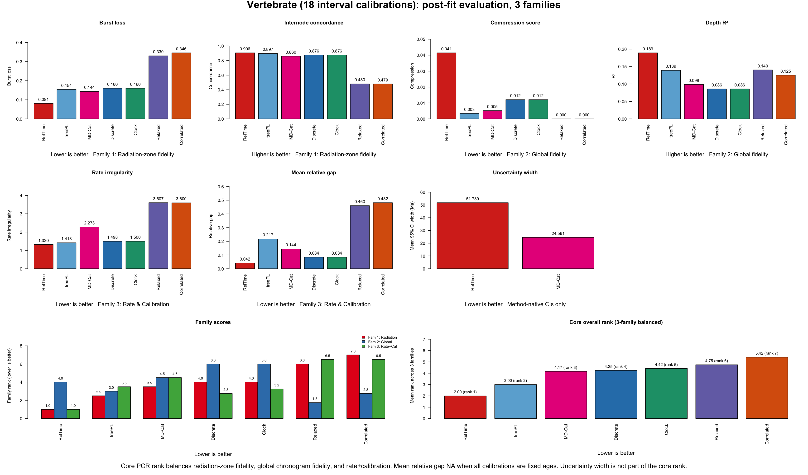

### Figure C: Vertebrate — dense calibrations

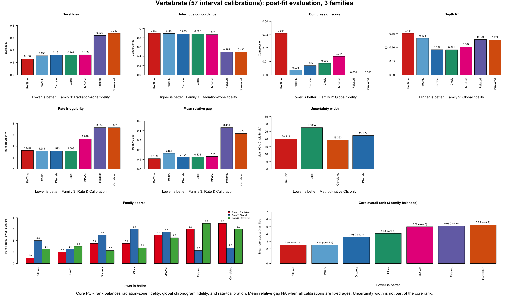

### Interpretation

- Sparse scheme: `RelTime` wins (2.00). It has the lowest burst loss (0.081), the best concordance (0.906), the best depth R² (0.189), the most regular rates (1.320) and the smallest gap (0.042). Its only weak score is compression (0.041, the highest)
- Sparse scheme: `treePL` is second (3.00). Its concordance (0.897) is almost as high as `RelTime`'s, and its compression is low (0.003)
- Sparse scheme: `MDCat` is third (4.17). Its burst loss is second best (0.144), but its rates are the least regular outside the correlated/relaxed pair (2.273)
- `chronos_clock` and `chronos_discrete` are nearly the same tree in the sparse scheme (all core metrics agree to two digits)
- `chronos_correlated` and `chronos_relaxed` have no compression and a good depth R², but the worst burst loss (about 0.33), concordance (about 0.48), rates (about 3.6) and gaps (about 0.47)
- Dense scheme: `RelTime` and `treePL` tie for first (2.50). `RelTime` has the lowest burst loss (0.130), the best concordance (0.897), the best depth R² (0.151) and the smallest gap (0.109). `treePL` has the most regular rates (1.581) and is second on burst loss (0.155), concordance (0.892) and depth R² (0.133)
- With more calibrations, `RelTime` drops from first to fourth on rate regularity (1.638). This is what lets `treePL` draw level
- Dense scheme: `chronos_discrete` (3.58) and `chronos_clock` (4.08) are third and fourth. `MDCat` is fifth (5.00); its rates (2.648) are less regular than all but the correlated/relaxed pair
- Intervals: in the sparse scheme only `RelTime` (Tao, 51.79 Ma) and `MDCat` (24.56 Ma) have them, and Tao intervals are wider than bootstrap ones. In the dense scheme the bootstrap widths are close: 19.35–27.68 Ma for `chronos`, 20.12 Ma for `RelTime` and 21.70 Ma for `MDCat`

<details>
<summary><strong>Files behind this example</strong></summary>

Raw trees, calibration tables, and PCR output CSVs are withheld because the dataset is unpublished.

- `scripts/run_pcr.R`
- `scripts/make_all_postfit_figures.R`

</details>

## Example 4: Unpublished Gobiaria dataset (495 tips)

This goby-dominated dataset is the McCraney RAxML phylogram (495 tips: 404 Gobiiformes and 91 Kurtiformes; 140 pulse-panel clades, 74 radiation zones). The calibration set (75 ages congruified from the McCraney chronogram, without the kurtiform calibrations and with *Eosphaeramia* added to Apogoninae) has 74 point ages and one interval (48.5–85.9 Ma). The source chronogram was in units of 100 Myr; this example now uses Ma throughout: the calibrations and the `chronos` and `MDCat` trees (with their intervals) were multiplied by 100 (an exact change of units), and `treePL` and `RelTime` were dated in Ma. In 100-Myr units treePL's cross-validation was about 300 times slower, because every branch duration is tiny.

Candidates: three `chronos` models from the earlier pipeline run, `treePL` (cross-validated smoothing 0.00001; the CV curve is flat below 0.0001), `RelTime` via MEGA-CC (the earlier `RelTime` trees came from the removed R implementation), and `MDCat`. `chronos_relaxed` is left out: its root (257 Ma) breaks the 85.9 Ma root calibration.

### Ranked post-fit results (74 point ages + 1 interval)

<!-- pcr-table: GOBIES/GOBY_TREES/McCraney_minus_kurtiform_cals_plus_eosphaeramia_apogoninae/pcr_rebuild/summary_pcr_metrics.csv -->
| candidate | burst loss | int. concordance | compression | depth R² | rate irregularity | mean relative gap | uncertainty width (Ma) | Fam 1 | Fam 2 | Fam 3 | core rank |
| --- | ---: | ---: | ---: | ---: | ---: | ---: | ---: | ---: | ---: | ---: | ---: |
| `chronos_correlated_lambda1` | 0.358 | 0.856 | 0.000 | 0.135 | 1.255 | 0.000 | 0.95 | 3.50 | 2.00 | 1.75 | **2.42** |
| `treePL_smooth0p00001` | 0.354 | 0.848 | 0.000 | 0.036 | 1.724 | 0.000 | NA | 2.50 | 3.50 | 3.75 | 3.25 |
| `chronos_clock_lambda1` | 0.356 | 0.839 | 0.000 | 0.035 | 1.548 | 0.000 | 3.42 | 4.00 | 4.25 | 3.00 | 3.75 |
| `chronos_discrete_lambda1_k2` | 0.356 | 0.839 | 0.000 | 0.035 | 1.548 | 0.000 | 2.94 | 4.00 | 4.25 | 3.00 | 3.75 |
| `RelTime_MEGA` | 0.364 | 0.872 | 0.006 | 0.132 | 1.268 | 0.038 | 4.16 | 3.50 | 4.00 | 4.00 | 3.83 |
| `MDCat` | 0.352 | 0.831 | 0.000 | 0.037 | 1.765 | 0.001 | 4.11 | 3.50 | 3.00 | 5.50 | 4.00 |

### Figure: Post-fit comparison across metric families

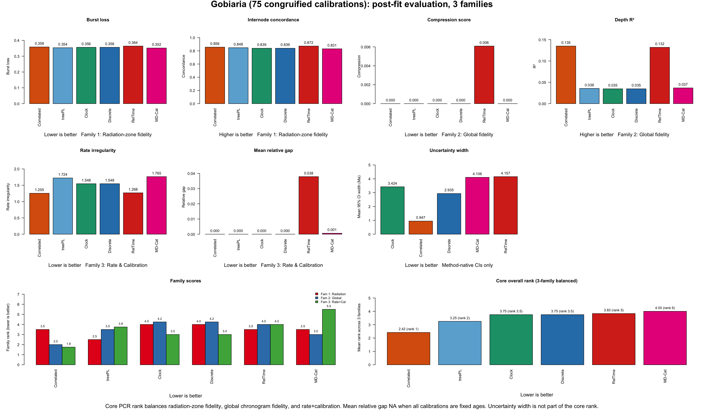

### Interpretation

- `chronos_correlated` wins (2.42). It has the most regular rates (1.255) and, with `RelTime`, the best depth R² (0.135), so it leads Families 2 and 3. Gobiaria is the only dataset here where a non-clock `chronos` model leads
- `treePL` is second (3.25), with the second-lowest burst loss (0.354) but a low depth R² (0.036)
- `RelTime` has the best internode concordance (0.872) and rates almost as regular as `chronos_correlated` (1.268), but it puts the interval-calibrated node furthest above its minimum (gap 0.038; the others are at or near 0) and it has some compression (0.006), which puts it fifth (3.83)
- `MDCat` is last (4.00): its burst loss is the lowest (0.352), but its rates are the least regular (1.765)
- The six candidates are close on radiation-zone fidelity (burst loss 0.352–0.364), so Families 2 and 3 decide the order
- Interval widths are in Ma; `chronos_correlated` has the narrowest bootstrap intervals (0.95 Ma), `RelTime` (4.16 Ma) and `MDCat` (4.11 Ma) the widest

<details>
<summary><strong>Files behind this example</strong></summary>

Raw trees, calibration tables, and PCR output CSVs are withheld because the dataset is unpublished.

- `scripts/run_pcr.R`
- `scripts/make_all_postfit_figures.R`

</details>

## Example 5: Unpublished Tetraodontiformes dataset (327 tips)

This pufferfish-dominated dataset (327 tips; 95 pulse-panel clades, 47 radiation zones) is dated under a **sparse** scheme (38 congruified point ages) and a **dense** scheme (120 congruified point ages; the sparse set is a subset). All calibrations are fixed ages, so `mean_relative_gap` is NA. The `chronos` and `RelTime` trees come from the earlier pipeline runs; `treePL` was redated with cross-validated smoothing (random CV with replicates; smoothing 1 sparse, 0.00001 dense, where the CV curve is nearly flat below 0.0001), and `MDCat` was added. `chronos_relaxed` gives the same tree as `chronos_correlated` in both schemes and is scored once. In the sparse scheme only `RelTime` (Tao) and `MDCat` (Poisson bootstrap) carry intervals.

In both schemes treePL's own default optimizer settings reached a better objective than the primed settings, and the settings disagree on node ages by a median of about 8% (sparse). The pipeline keeps the best objective, but these treePL dates are sensitive to optimizer settings.

### Scheme 1: Sparse calibrations (38 congruified ages)

<!-- pcr-table: 5_DATASETS_FEW_CALS/tetraodontiformes/pcr_rebuild/summary_pcr_metrics.csv -->
| candidate | burst loss | int. concordance | compression | depth R² | rate irregularity | uncertainty width (Ma) | Fam 1 | Fam 2 | Fam 3 | core rank |
| --- | ---: | ---: | ---: | ---: | ---: | ---: | ---: | ---: | ---: | ---: |
| `RelTime_MEGA` | 0.211 | 0.863 | 0.015 | 0.066 | 2.805 | 7.07 | 1.00 | 3.75 | 1.00 | **1.92** |
| `chronos_clock_lambda1` | 0.230 | 0.813 | 0.003 | 0.056 | 3.170 | NA | 2.50 | 4.50 | 2.00 | 3.00 |
| `treePL_smooth1` | 0.289 | 0.816 | 0.000 | 0.061 | 3.658 | NA | 3.50 | 2.25 | 4.00 | 3.25 |
| `chronos_discrete_lambda1_k2` | 0.238 | 0.808 | 0.003 | 0.060 | 3.415 | NA | 3.50 | 4.00 | 3.00 | 3.50 |
| `chronos_correlated_lambda0p01` | 0.425 | 0.428 | 0.000 | 0.066 | 5.023 | NA | 6.00 | 1.50 | 6.00 | 4.50 |
| `MDCat` | 0.276 | 0.801 | 0.003 | 0.054 | 3.941 | 5.30 | 4.50 | 5.00 | 5.00 | 4.83 |

### Scheme 2: Dense calibrations (120 congruified ages)

<!-- pcr-table: 5_DATASETS_MANY_CALS/tetraodontiformes/pcr_rebuild/summary_pcr_metrics.csv -->
| candidate | burst loss | int. concordance | compression | depth R² | rate irregularity | uncertainty width (Ma) | Fam 1 | Fam 2 | Fam 3 | core rank |
| --- | ---: | ---: | ---: | ---: | ---: | ---: | ---: | ---: | ---: | ---: |
| `RelTime_MEGA` | 0.264 | 0.847 | 0.015 | 0.078 | 3.164 | 3.41 | 2.00 | 3.50 | 1.00 | **2.17** |
| `chronos_clock_lambda1` | 0.267 | 0.837 | 0.000 | 0.076 | 3.334 | 1.81 | 3.50 | 2.50 | 2.50 | 2.83 |
| `chronos_discrete_lambda1_k2` | 0.267 | 0.837 | 0.000 | 0.076 | 3.334 | 1.87 | 3.50 | 2.50 | 2.50 | 2.83 |
| `treePL_smooth0p00001` | 0.275 | 0.871 | 0.000 | 0.076 | 4.015 | NA | 2.50 | 2.50 | 5.00 | 3.33 |
| `MDCat` | 0.279 | 0.849 | 0.006 | 0.075 | 3.986 | 2.73 | 3.50 | 5.00 | 4.00 | 4.17 |
| `chronos_correlated_lambda0p01` | 0.303 | 0.769 | 0.003 | 0.073 | 4.973 | 0.03 | 6.00 | 5.00 | 6.00 | 5.67 |

### Figure B: Tetraodontiformes — sparse calibrations

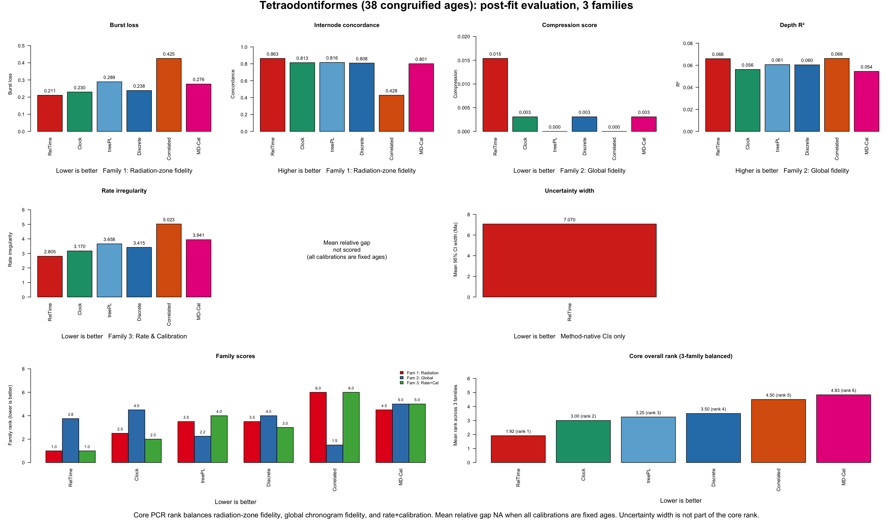

### Figure C: Tetraodontiformes — dense calibrations

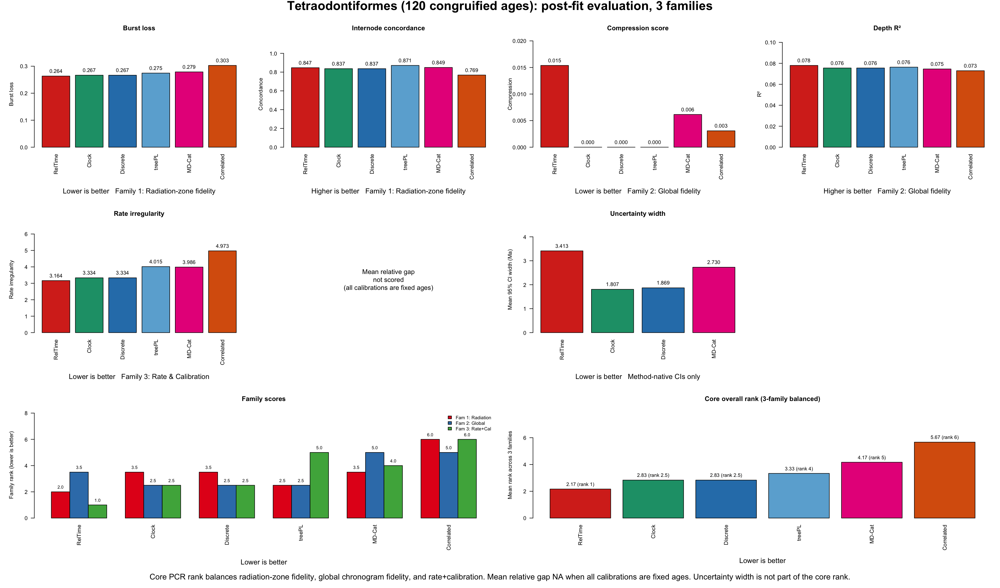

### Interpretation

- `RelTime` wins under both schemes (1.92 sparse, 2.17 dense). It has the most regular rates in both, and the best burst loss and concordance in the sparse scheme
- `chronos_clock` is second in both (3.00 sparse; tied with `chronos_discrete` at 2.83 dense, where the two are the same to three digits)
- `treePL` is third or fourth (3.25 sparse, 3.33 dense). In the dense scheme it has the best internode concordance (0.871), but its rates are the second least regular
- `MDCat` is fifth (4.83 sparse, 4.17 dense). Its burst loss and concordance are close to the field, but its rates are less regular than those of `RelTime` and the clock-like `chronos` models
- `chronos_correlated` (= `chronos_relaxed`) has the best global fidelity in the sparse scheme but the worst radiation-zone and rate scores in both
- Intervals: `MDCat`'s are narrower than `RelTime`'s in both schemes (5.30 vs 7.07 Ma sparse, where `RelTime` has Tao intervals; 2.73 vs 3.41 Ma dense) and wider than those of the clock-like `chronos` models in the dense scheme (1.81–1.87 Ma). With 120 point ages many nodes are fixed, which pulls every mean width down

<details>
<summary><strong>Files behind this example</strong></summary>

Raw trees, calibration tables, and PCR output CSVs are withheld because the dataset is unpublished.

- `scripts/run_pcr.R`
- `scripts/make_all_postfit_figures.R`

</details>

## Example 6: Unpublished Ostariophysi dataset (2229 tips)

This large freshwater fish dataset covers Otophysi (Cypriniformes, Characiformes, Siluriformes and Gymnotiformes; 2229 tips, 646 pulse-panel clades, 368 radiation zones). It is the only example here with primary fossil calibrations: 54 minimum-only fossil ages, one interval (94.5–96.5 Ma) and a root interval with a maximum of 211 Ma. The root minimum is 0.000001 Ma, so the root is left out of the relative gap (calibrations with `age_min` < 0.01 Ma give meaningless ratios).

Candidates: four `chronos` models and `RelTime` from the earlier pipeline run, `treePL`, and `MDCat`. Because the tree has more than 1000 tips, `treePL` cross-validation ran on a 1114-tip subset that keeps every calibration and the rate-outlier lineages; the chosen smoothing (0.01) was then used on the full tree. treePL's own default optimizer settings reached the best objective. The other settings give node ages that differ from that tree by a median of up to 20.1%, so these treePL dates are again sensitive to optimizer settings. `MDCat` used 5 random starts; all calibrated nodes are inside their bounds.

### Ranked post-fit results (56 fossil calibrations, 7 candidates)

<!-- pcr-table: ../Ostario/run1_plusAfro_plusCall/pcr_rebuild/summary_pcr_metrics.csv -->
| candidate | burst loss | int. concordance | compression | depth R² | rate irregularity | mean relative gap | uncertainty width (Ma) | Fam 1 | Fam 2 | Fam 3 | core rank |
| --- | ---: | ---: | ---: | ---: | ---: | ---: | ---: | ---: | ---: | ---: | ---: |
| `RelTime_MEGA` | 0.248 | 0.895 | 0.018 | 0.104 | 1.052 | 1.395 | 8.90 | 3.00 | 2.00 | 1.50 | **2.17** |
| `treePL_smooth0p01` | 0.277 | 0.805 | 0.002 | 0.071 | 2.250 | 1.379 | NA | 4.00 | 1.50 | 1.50 | 2.33 |
| `chronos_discrete_lambda1_k2` | 0.162 | 0.779 | 0.094 | 0.061 | 3.177 | 1.545 | NA | 4.00 | 3.50 | 3.50 | 3.67 |
| `chronos_clock_lambda1` | 0.159 | 0.771 | 0.110 | 0.060 | 3.256 | 1.641 | 0.31 | 4.00 | 4.50 | 4.50 | 4.33 |
| `MDCat` | 0.285 | 0.786 | 0.005 | 0.051 | 2.311 | 1.752 | NA | 5.00 | 4.50 | 4.50 | 4.67 |
| `chronos_correlated_lambda1` | 0.140 | 0.745 | 0.161 | 0.059 | 3.596 | 1.691 | NA | 3.50 | 6.25 | 5.50 | 5.08 |
| `chronos_relaxed_lambda0p1` | 0.146 | 0.718 | 0.112 | 0.059 | 4.271 | 2.288 | NA | 4.50 | 5.75 | 7.00 | 5.75 |

Only `RelTime` (bootstrap) and `chronos_clock` carry intervals here.

### Figure: Post-fit comparison across metric families

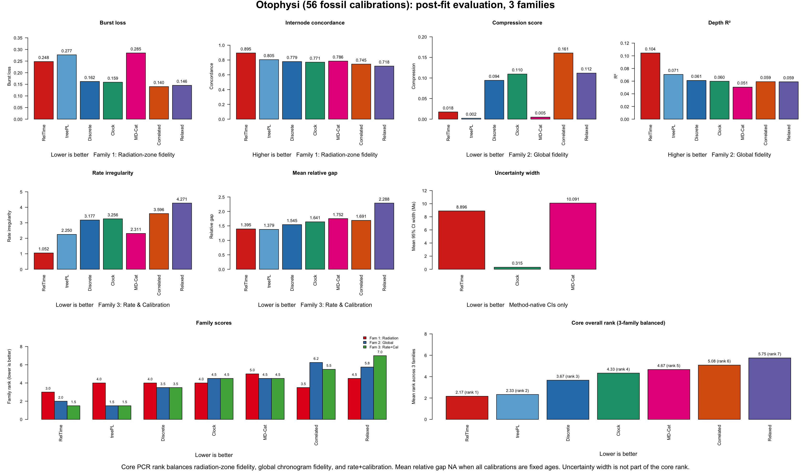

### Compression of young clades in `chronos`

All four `chronos` trees collapse many internal branches to near zero: `compression_score` is 0.094–0.161, against 0.018 or less for `RelTime`, `treePL` and `MDCat`. The collapse is in young radiations. In the Australasian–New Guinean sea catfishes (Ariidae, 26 tips), the crown is 0.06 Ma in `chronos_correlated`, 0.09 Ma in `chronos_relaxed`, 0.18 Ma in `chronos_clock` and 0.30 Ma in `chronos_discrete`. `RelTime`, `MDCat` and `treePL` put it at 7.9, 6.6 and 6.3 Ma.

The deep nodes are not preserved either. The crowns of the four orders are about 25–40 Myr older in the `chronos` trees than in `RelTime` and `treePL` (Siluriformes: 137–160 Ma in `chronos`, 114 Ma in `RelTime`, 119 Ma in `treePL`). So `chronos` stretches the deep part of the tree and squeezes the young radiations into near-polytomies. The low internode concordance of the `chronos` trees (0.718–0.779, against 0.895 for `RelTime`) shows the same distortion inside radiation zones.

### Interpretation

- `RelTime` wins (2.17). It has the best concordance (0.895), depth R² (0.104) and rate regularity (1.052)
- `treePL` is a close second (2.33). It has the lowest compression (0.002) and the smallest gap (1.379, just ahead of `RelTime` at 1.395), but less regular rates (2.250)
- `chronos_discrete` (3.67) and `chronos_clock` (4.33) come next. The `chronos` models have the lowest burst loss (0.140–0.162), but that comes from the collapsed young clades, and they lose on compression, concordance and rates
- `MDCat` is fifth (4.67). Its compression is low (0.005), but it has the highest burst loss (0.285) and the largest gap outside `chronos_relaxed` (1.752)
- `chronos_correlated` (5.08) and `chronos_relaxed` (5.75) are last
- This dataset shows why `compression_score` is part of PCR: burst loss alone would favor the `chronos` trees

<details>
<summary><strong>Files behind this example</strong></summary>

Raw trees, calibration tables, and PCR output CSVs are withheld because the dataset is unpublished.

- `scripts/run_pcr.R`
- `scripts/make_all_postfit_figures.R`

</details>

---

## Cross-dataset summary

Six datasets, nine comparisons (Syngnatharia, Gobiaria and Ostariophysi have one calibration scheme each; the others have a sparse and a dense scheme). Core ranks are in parentheses; "MD-Cat place" is its place among the scored candidates.

| Dataset | Tips | Calibrations | Winner | Second | MD-Cat place |
| --- | ---: | --- | --- | --- | --- |
| Syngnatharia | 164 | 13–14 fossil minima and intervals | `RelTime` (1.33) | `MDCat` (2.17) | 2 of 3 |
| Terapontoidei, sparse | 105 | 6 congruified point ages | `RelTime` (1.33) | `chronos_discrete` (3.33) | 6 of 6 |
| Terapontoidei, dense | 105 | 19 congruified point ages | `RelTime` (1.33) | `chronos_discrete` (2.50) | 5 of 6 |
| Vertebrate, sparse | 581 | 18 congruified intervals | `RelTime` (2.00) | `treePL` (3.00) | 3 of 7 |
| Vertebrate, dense | 581 | 57 congruified intervals | `RelTime` = `treePL` (2.50) | `chronos_discrete` (3.58) | 5 of 7 |
| Tetraodontiformes, sparse | 327 | 38 congruified point ages | `RelTime` (1.92) | `chronos_clock` (3.00) | 6 of 6 |
| Tetraodontiformes, dense | 327 | 120 congruified point ages | `RelTime` (2.17) | `chronos_clock` = `chronos_discrete` (2.83) | 5 of 6 |
| Gobiaria | 495 | 74 congruified point ages + 1 interval | `chronos_correlated` (2.42) | `treePL` (3.25) | 6 of 6 |
| Ostariophysi | 2229 | 56 fossil minima and intervals | `RelTime` (2.17) | `treePL` (2.33) | 5 of 7 |

- **`RelTime`** wins 7 of the 9 comparisons outright and ties `treePL` for first in Vertebrate dense. It usually has the lowest burst loss or the best concordance, and the most regular rates
- **`chronos_correlated`** wins only in Gobiaria. There all candidates are close on burst loss (0.352–0.364), and it has the most regular rates and the best depth R²
- **`MDCat`** never wins. Its best result is second in Syngnatharia; elsewhere it places between third and last. With fixed ages it often keeps the burst structure well, but its rates are usually less regular than those of `RelTime` and the clock-like `chronos` models
- **`treePL`** ties `RelTime` for first in Vertebrate dense and is second in Vertebrate sparse, Gobiaria and Ostariophysi. In Vertebrate (both schemes), Tetraodontiformes sparse and Ostariophysi, other optimizer settings give node ages that differ from the chosen tree by a median of 8–28%, so these treePL dates are less stable than the rank suggests
- **Calibration density** does not change the winner. `RelTime` is first under both schemes in Terapontoidei, Vertebrate and Tetraodontiformes, although in Vertebrate dense it only ties `treePL`. Density mostly moves the lower places: `MDCat` gains one place in Terapontoidei and Tetraodontiformes and loses two in Vertebrate
- **Compression in `chronos`** is large only in Ostariophysi (0.094–0.161), the largest tree. There `chronos` also makes the deep nodes older. In the other datasets every candidate has compression of about 0.04 or less

<details>
<summary><strong>Scope notes</strong></summary>

- The family weights (1/3 each) are a design default. A broader sensitivity analysis has not yet been done across all datasets.
- The pulse family treats the source phylogram as the reference for branching rhythm. This is useful when asking whether a dated tree preserves the tempo structure visible in the starting phylogram, but it should not be read as proof that the phylogram itself is the true diversification history.
- `rate irregularity` is useful for comparing candidates within the same dataset, but absolute values are not meant to be compared across unrelated datasets.
- `mean_relative_gap` is computed only for calibrations with a window (a minimum-only age or an interval). Point ages give no gap, so it is NA when every calibration is a point age. With congruified intervals (Vertebrate, one Gobiaria node) the gap is scored, but it measures fit to secondary ages, not to fossils.
- Trees that are the same after rounding (for example `chronos_relaxed` and `chronos_correlated` in several datasets) are scored once.
- PCR reports raw scores and ranks. It does not yet attach bootstrap or permutation p-values to score differences.
- The framework evaluates point chronograms. It does not yet propagate posterior tree uncertainty through the post-fit scores.
- The optional `uncertainty width` layer uses the 95% intervals stored with each tree (`RelTime`: bootstrap or Tao; `chronos`: parametric bootstrap; `treePL` and `MDCat`: Poisson branch-length bootstrap; `MCMCTree`: HPD). It speaks to precision, not accuracy, and **does not contribute to the core rank**. Not every candidate has intervals: `treePL` has them only in Terapontoidei, and some `chronos` trees have none.

</details>
